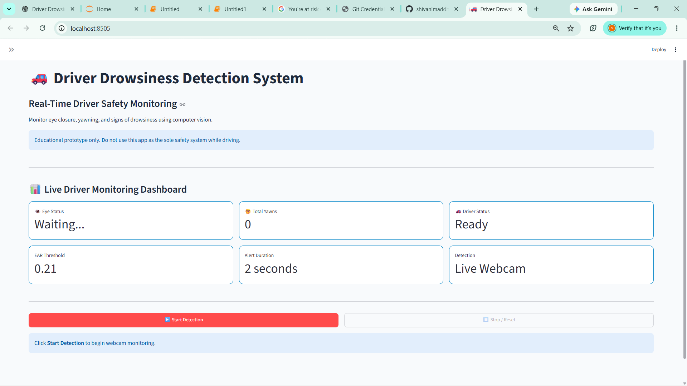

# 🚗 Driver Drowsiness Detection System

A real-time Driver Drowsiness Detection System built using Python, OpenCV, MediaPipe, and Streamlit. The project monitors facial landmarks to estimate eye closure and yawning, helping identify potential signs of driver fatigue.

## ✨ Features

- 👁️ **Eye Monitoring:** Uses the Eye Aspect Ratio (EAR) to detect eye closure.
- 🥱 **Yawn Detection:** Uses mouth landmarks to estimate mouth opening.
- 🔔 **Alert System:** Triggers an alarm when configured drowsiness conditions are met.
- 📊 **Interactive Dashboard:** Displays live monitoring metrics through Streamlit.
- 🤖 **Machine Learning Support:** Includes an optional Random Forest model, if available in the project setup.
- 📹 **Live Webcam Monitoring:** Processes camera frames for real-time detection.

## 🛠️ Technologies Used

- Python
- OpenCV
- MediaPipe
- Streamlit
- NumPy
- Scikit-learn (for the optional Random Forest model)

## 📁 Project Structure

```text
DriverDrowsiness/
├── app.py
├── face_landmarker.task
├── requirments.txt
├── Driver_Drowsiness.ipynb
├── data/
├── models/
└── src/
    ├── alarm.py
    ├── camera_test.py
    ├── config.py
    ├── drowsiness_detection.py
    ├── eye_detection.py
    ├── face_detection.py
    ├── feature_extraction.py
    └── yawn_detection.py
```

## ⚙️ Installation and Setup

### 1. Clone the repository

```bash
git clone https://github.com/shivanimaddheshiya15-create/Driver-Drowsiness-Detection.git
cd Driver-Drowsiness-Detection
```

### 2. Create a virtual environment

```bash
python -m venv venv
```

Activate it on Windows:

```powershell
.\venv\Scripts\Activate.ps1
```

### 3. Install dependencies

```bash
pip install -r requirments.txt
```

### 4. Run the application

```bash
streamlit run app.py
```

The application should open in your browser. Allow webcam access if prompted.

## 🧠 How It Works

1. Captures frames from the webcam.
2. Detects facial landmarks using MediaPipe.
3. Calculates the Eye Aspect Ratio (EAR) to estimate eye closure.
4. Estimates mouth opening to identify possible yawning.
5. Tracks configured conditions and triggers an alert when appropriate.
6. Displays monitoring information on the Streamlit dashboard.

## 🎯 Project Objective

The goal is to explore real-time computer vision techniques for identifying potential signs of driver drowsiness and generating alerts.

## ⚠️ Disclaimer

This is an educational prototype and is not a certified vehicle safety system. It should not be relied upon as the sole method for preventing accidents.

## 👩‍💻 Author

**Shivani Maddheshiya**

GitHub: [shivanimaddheshiya15-create](https://github.com/shivanimaddheshiya15-create)
## 📸 Project Screenshots

